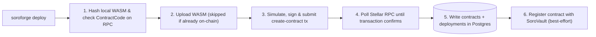

# Concepts

## Data model: `contracts` vs `deployments` (`internal/store`)

SoroForge separates **what is currently live** from **every change that happened over time** across two Postgres tables in `internal/store`:

- **`contracts` (current state per `(network, alias)`)** — stores one row per tracked contract on a network: the `alias`, `network`, active `contract_id` (`C...`), currently recorded `wasm_hash`, and timestamps. `soroforge list` and `soroforge status` read from this table.
- **`deployments` (append-only lineage)** — records an immutable event row for every confirmed `deploy` or `upgrade`: the `alias`, `network`, `contract_id`, `action` (`deploy` or `upgrade`), `wasm_hash`, deployer public address (`G...`), transaction hash, confirmed ledger sequence, operator `notes`, and timestamp. `soroforge history <alias>` reads this table newest-first so prior versions and transaction hashes are never lost when a contract upgrades.

## The record-after-confirmation rule (`internal/deploy`)

In `internal/deploy`, SoroForge never writes a speculative or "pending" deployment row before the network accepts the transaction:

1. **Compute the SHA-256 `wasm_hash` and check on-chain code.** If the WASM binary is already uploaded on the target network, SoroForge skips the upload transaction and reuses the existing `wasm_hash`.
2. **Assemble and simulate.** Both the upload transaction (when needed) and the contract instantiation or `upgrade` invocation are simulated against Stellar RPC first. In `--dry-run` mode, SoroForge stops here, prints the transaction envelopes and derived contract address, and touches neither the signer, the network, Postgres, nor [SoroVault](../sorovault/README.md).
3. **Sign, submit, and wait for ledger confirmation.** Only after the transaction is signed, submitted, and confirmed in a closed ledger on Stellar RPC does SoroForge update `contracts` and append to `deployments` inside Postgres.
4. **Best-effort SoroVault catalog hook.** When the network block in `soroforge.yaml` configures `sorovault_url` (see [Configuration](configuration.md)), SoroForge registers or refreshes the confirmed contract in SoroVault and reports the outcome in the result's `catalog` field. Because the deployment itself is already confirmed and recorded, an unreachable SoroVault never rolls back or fails the deployment.

## Deploy vs upgrade

- **Deploy (`soroforge deploy <alias>`)** uploads the contract's WASM (if not already present on-chain), instantiates a new contract (with any configured `salt` and typed `constructor_args`), creates the initial `(network, alias)` row in `contracts`, and appends a `deploy` row to `deployments`.
- **Upgrade (`soroforge upgrade <alias>`)** uploads the new WASM binary and invokes the tracked contract's upgrade entrypoint (`upgrade_fn` in `soroforge.yaml`, defaulting to `upgrade`). If the local WASM hash already matches the recorded `wasm_hash`, `upgrade` is a safe no-op. Once confirmed on-chain, SoroForge updates `wasm_hash` on the `contracts` row and appends an `upgrade` row to `deployments` while preserving all earlier history rows (see [CLI & API reference](reference.md)).

## Drift detection and status states

`soroforge status <alias>` (and `soroforge status --all`) compares what SoroForge recorded in `contracts` against the live ledger state on Stellar RPC and reports one of four states:

| Status state | Exit code | Meaning in the database and on-chain |
|---|---|---|
| `in_sync` | `0` | The contract is recorded in `contracts`, exists on-chain, and its live on-chain `wasm_hash` matches the recorded `wasm_hash`. |
| `drift` | `2` | The contract is recorded in `contracts` and exists on-chain, but its live on-chain `wasm_hash` differs from the recorded `wasm_hash` (for example, an upgrade was performed outside SoroForge). |
| `untracked` | `2` | The alias is defined in `soroforge.yaml`, but no deployment record exists for `(network, alias)` in the `contracts` table yet. |
| `missing` | `2` | A deployment record exists in `contracts`, but the contract instance or code entry is missing or expired on-chain (for example, after a testnet reset or TTL archival). |

If the check itself cannot be completed (such as an unreachable RPC endpoint or database error), `soroforge status` exits `1`. Running `soroforge status --all` in CI provides a single gate across every contract on the target network.

## Dry-run and multi-network isolation

- **Dry-run (`--dry-run`)** builds and simulates the exact transactions SoroForge would submit without requiring `SOROFORGE_SECRET_KEY` or `DATABASE_URL`, making it the standard pre-flight check before mainnet operations.
- **Multi-network namespacing** scopes every `contracts` and `deployments` record by `network`. Deploying `counter` to `testnet` and later to `mainnet` maintains independent contract IDs, WASM hashes, and deployment timelines without collision.
