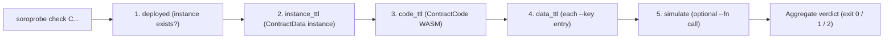

# Concepts

## Simulation

Soroban lets you *simulate* a contract invocation — run it against the current ledger state without submitting a transaction — to learn what it would do. SoroProbe builds the invocation transaction envelope, sends it to the Stellar RPC `simulateTransaction` endpoint, and presents the outcome: whether it would succeed, what it would return (decoded from `ScVal` into readable JSON), the CPU instruction and memory resource costs, the read/write ledger footprint, and `RESTORE REQUIRED` when archived ledger entries block execution.

Because nothing is signed or submitted, simulation is free, safe, and repeatable — the ideal way to verify a call before committing to it.

## State health, statuses, and threshold evaluation

Soroban contract state does not live forever by default: ledger entries carry a `liveUntilLedgerSeq` TTL and expire (become archived or deleted depending on durability) if their rent is not extended, after which calls that depend on them begin failing.

In `internal/health`, SoroProbe compares each entry's remaining TTL (`remaining = liveUntilLedgerSeq - latestLedger`) against two configurable thresholds (`WARN_LEDGERS`, default `120960` ≈ 7 days, and `CRITICAL_LEDGERS`, default `17280` ≈ 1 day; see [Configuration](configuration.md)) and assigns one of five ordered statuses:

| Status (best → worst) | Condition | Meaning | Fails `soroprobe check`? |
|---|---|---|---|
| `healthy` | `remaining > WARN_LEDGERS` | Entry is live with ample TTL headroom | No (exit `0`) |
| `warning` | `CRITICAL_LEDGERS < remaining <= WARN_LEDGERS` | Entry is live now, but its TTL should be extended soon | **No (exit `0`)** |
| `critical` | `0 < remaining <= CRITICAL_LEDGERS` | Entry is within the critical window and at imminent risk of expiring | Yes (exit `1`) |
| `expired` | `remaining <= 0` (`liveUntilLedgerSeq <= latestLedger`) | Entry has already expired / archived on-chain | Yes (exit `1`) |
| `missing` | Entry not found on the ledger | Contract instance, WASM code, or requested data key does not exist | Yes (exit `1`) |

### Why warnings never fail a check

`warning` is designed as an early-notice window (roughly a week before expiration by default) so operators and scheduled maintenance jobs can extend TTLs without blocking deployment pipelines or waking an on-call engineer. Only actionable failures that threaten immediate availability — `critical`, `expired`, and `missing`, or a failing simulation — cause `soroprobe check` to exit `1`.

## The combined check (`internal/probe/check.go`)

`soroprobe check` executes a deterministic sequence of steps in `internal/probe/check.go` so CI pipelines get a complete diagnostic pass in one command (see [CLI & API reference](reference.md)):

1. **`deployed`** — fetches the contract's `ContractData` instance entry and verifies the contract is deployed on the configured network.
2. **`instance_ttl`** — evaluates the TTL health (`healthy`, `warning`, `critical`, `expired`, `missing`) of the contract instance entry.
3. **`code_ttl`** — resolves the WASM hash referenced by the instance, fetches the corresponding `ContractCode` ledger entry, and evaluates its TTL health.
4. **`data_ttl`** — for every storage key passed via `--key <type:value>` (with `--durability persistent|temporary`), fetches the `ContractData` entry and evaluates its TTL health.
5. **`simulate` (optional)** — when `--fn <function>` is supplied (along with any `--arg` flags), simulates the read-only invocation and checks that it succeeds without requiring state restoration.

The overall check passes (exit `0`) when every executed step is `healthy` or `warning` and any requested simulation succeeds. If any step reports `critical`, `expired`, `missing`, or a failed simulation, `soroprobe check` exits `1`. If the check itself could not run (for example, invalid CLI flags or an unreachable RPC endpoint), it exits `2`.

## Argument and result encoding

Contract calls take and return Soroban `ScVal` XDR values. SoroProbe accepts human-friendly `type:value` arguments (`u32:5`, `i128:-100`, `sym:transfer`, `addr:G...`, plus JSON `vec:[...]` and `map:[...]` collections), encodes them to `ScVal` for simulation, and decodes returned `ScVal` values into structured JSON. When `--sorovault-url` (`SOROVAULT_URL`) is configured, SoroProbe fetches the contract's decoded ABI from SoroVault and automatically types bare arguments against the function signature before simulating.

## Read-only guarantee and fixture-based testing

- **Read-only by design.** SoroProbe is stateless: it has no database, never holds secret keys, and never submits transactions. Configuration validation enforces that `SOURCE_ACCOUNT` is a valid `G...` ed25519 public key (defaulting to the all-zero placeholder account) and immediately rejects `S...` secret seeds, keeping its security surface minimal in automated CI environments.
- **Fixture-based testing keeps SoroProbe honest.** All RPC interactions, XDR encoding/decoding, and ABI lookups sit behind small Go interfaces. Unit and integration tests run against recorded ledger-entry and simulation XDR fixtures rather than a live RPC node, ensuring `go test ./...` is fast, deterministic, offline-capable, and never flakes when a public testnet resets.
