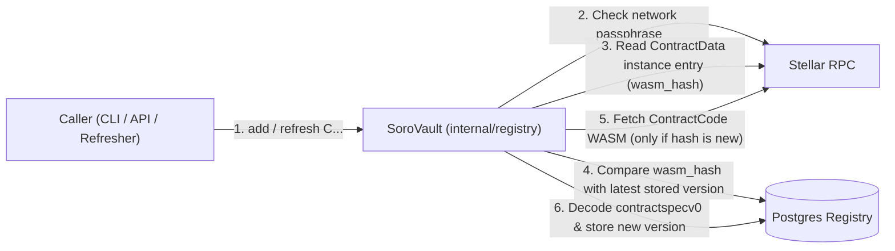

# Concepts

## Contract interfaces (specs)

Every Soroban contract's WASM carries a **spec** (`contractspecv0` custom section): a machine-readable XDR description of the functions it exposes — their names, parameter names and types, return types, docstrings — along with any user-defined structs, enums, error enums, and events (`SCSpecEntry`). This is the contract's ABI. SoroVault fetches that spec from the chain, decodes it into a clean, versioned JSON model, and serves it through the CLI, HTTP API, and web UI.

## How registration and refresh work

### Registration (`sorovault add` / `POST /api/contracts`)

When you register a contract in `internal/registry`:

1. **Verify the network passphrase.** SoroVault queries the RPC endpoint's live network passphrase and compares it with `NETWORK_PASSPHRASE` (see [Configuration](configuration.md)). If they disagree, registration aborts (`503` on the HTTP API) so contracts from one network can never be filed under another.
2. **Read the contract instance entry.** SoroVault reads the contract's `ContractData` instance ledger entry to obtain its active 32-byte `wasm_hash`. If the contract does not exist on-chain, SoroVault returns `404`; if the instance has no WASM executable (such as a built-in Stellar Asset Contract) or the WASM contains no spec section, it returns `422`.
3. **Fetch and decode the WASM spec.** SoroVault fetches the `ContractCode` ledger entry for that `wasm_hash`, extracts the embedded `contractspecv0` XDR entries, and decodes functions, user-defined types, error codes, and events into the public ABI JSON model (`abi_version`).
4. **Persist the contract and version.** SoroVault upserts the contract record keyed by `(network, contract_id)` with its current `wasm_hash` and inserts an immutable version record keyed by `(network, contract_id, wasm_hash)` into Postgres. If the contract and `wasm_hash` are already stored, registration is idempotent (`200 OK` on the API; `201 Created` when newly registered).

### Refresh (`sorovault refresh` / `POST /api/contracts/{id}/refresh` / `internal/refresher`)

Contracts can be upgraded on-chain to point at a new WASM binary. When SoroVault refreshes a registered contract — either on demand or during a background `REFRESH_INTERVAL` sweep in `internal/refresher`:

1. **Single ledger-entry check first.** SoroVault reads only the contract's `ContractData` instance entry from Stellar RPC to inspect its current on-chain `wasm_hash` and compares it with the contract's stored `wasm_hash`.
2. **Skip unchanged contracts cheaply.** If the on-chain `wasm_hash` matches the latest stored version, SoroVault updates the contract's `refreshed_at` timestamp and stops there — the WASM bytecode is **not** re-downloaded or re-decoded.
3. **Record upgrades as new versions.** If the on-chain `wasm_hash` has changed, SoroVault fetches the new `ContractCode` entry, decodes the new spec, inserts a new version row for the new `wasm_hash`, and advances the contract's current pointer to that version. During background sweeps, a contract that fails to refresh is logged and skipped so the rest of the sweep continues uninterrupted.

## Versioning by WASM hash (append-only history)

SoroVault identifies every interface version by the lowercase hex SHA-256 `wasm_hash` of the contract bytecode that produced it:

- **Versions are never overwritten.** Upgrading a contract adds a new version row alongside the existing ones and updates which `wasm_hash` is marked current. Prior versions remain intact in Postgres forever.
- **Deterministic pinning.** Because a `wasm_hash` is a content hash of the WASM binary, the decoded ABI for a given `wasm_hash` never changes. Callers can inspect the full lineage via `GET /api/contracts/{id}/versions` and pin either the JSON ABI (`GET /api/contracts/{id}?wasm_hash=<hash>`) or the generated TypeScript client (`GET /api/contracts/{id}/client.ts?wasm_hash=<hash>`) to an exact historical version (see [API & CLI reference](reference.md)).

## How search works (current interface only)

`sorovault list -q <query>` and `GET /api/contracts?q=<query>` run a case-insensitive substring match across:

- the contract ID (`C...`) and optional human-readable contract name, and
- the names of **functions**, **user-defined types**, and **events** in each contract's **current** interface version.

Historical (superseded) versions are intentionally excluded from symbol search so that a function removed in an upgrade does not surface the contract as a false positive for callers looking for live entrypoints. Each search hit returns a `matches` array listing the exact symbol names in the current interface that matched the query.

## Network namespacing

Every contract and version record in SoroVault is scoped by `network` (for example `testnet` or `mainnet`). The same contract ID or WASM hash can exist independently on multiple networks without colliding, and all list, get, version, and refresh queries filter by network. Coupled with the startup and per-request `NETWORK_PASSPHRASE` check, this guarantees strict isolation between environments.

## A usable ABI and typed codegen

The decoded interface is exposed as stable JSON (`abi_version`) that downstream tools consume directly:

- **TypeScript client generation (`sorovault codegen` / `/client.ts`)** turns the stored structs, unions, enums, error codes, and function signatures into a strict TypeScript module wrapping `@stellar/stellar-sdk`'s `contract.Client`.
- **SoroProbe argument typing** reads the stored ABI from SoroVault (`--sorovault-url`) to type bare CLI/API arguments and catch unknown function names or arity mismatches before simulation.

## Read-only and safe

SoroVault only reads from the chain and writes to its own registry. It never holds signing keys, never submits transactions, and never executes contract WASM — it is a catalog, not an actor.
